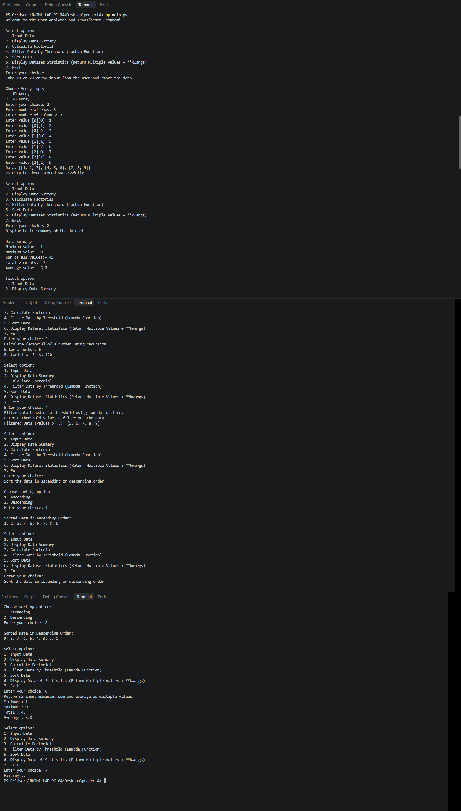

# 📊 Data Analyzer and Transformer Program

## 📝 Project Description

The **Data Analyzer and Transformer Program** is a Python-based console application designed to **input, analyze, filter, sort, and transform numerical datasets**.

The program supports both **1D and 2D arrays** and demonstrates important Python programming concepts such as functions, recursion, lambda functions, keyword arguments, built-in functions, and returning multiple values.

---

## ✨ Features

* 📥 Input data as a **1D Array**
* 📋 Input data as a **2D Array**
* 🔄 Convert 2D data into 1D data
* 📊 Display data summary

  * 🔽 Minimum value
  * 🔼 Maximum value
  * ➕ Sum of values
  * 🔢 Total number of elements
  * 📈 Average value
* 🧮 Calculate factorial using **recursion**
* 🔍 Filter data using a **Lambda Function**
* ↕️ Sort data

  * ⬆️ Ascending order
  * ⬇️ Descending order
* 📊 Display dataset statistics
* 🔢 Return multiple values from a function
* 🔑 Use `**kwargs` to display statistics
* 🖥️ Interactive menu-driven program
* 📚 Uses Python documentation strings

---

## 🛠️ Technologies Used

| Technology                | Purpose                                |
| ------------------------- | -------------------------------------- |
| 🐍 **Python**             | Main programming language              |
| 💻 **Visual Studio Code** | Code editor                            |
| 🔧 **Git**                | Version control                        |
| 🐙 **GitHub**             | Repository hosting and project sharing |

---

## ⚙️ How to Run / Installation

### 1️⃣ Install Python

Download and install Python on your computer.

Check whether Python is installed:

```bash
python --version
```

---

### 2️⃣ Clone the Repository

Clone the project from GitHub:

```bash
git clone <YOUR_GITHUB_REPOSITORY_URL>
```

Then open the project folder:

```bash
cd Data-Analyzer-and-Transformer
```

---

### 3️⃣ Open in VS Code

Open the project folder in **Visual Studio Code**.

You can also use:

```bash
code .
```

---

### 4️⃣ ▶️ Run the Program

Run the Python program using:

```bash
python main.py
```

You can also run it directly using the **Run Python File ▶️** button in VS Code.

---

## 📁 Project Structure

```text
Data-Analyzer-and-Transformer/
│
├──  main.py
├──  output.png
├──  README.md
```
## output


---

## 📋 Main Menu

The program provides the following options:

```text
╔══════════════════════════════════════════╗
║       📊 DATA ANALYZER PROGRAM          ║
╠══════════════════════════════════════════╣
║  1️⃣  Input Data                         ║
║  2️⃣  Display Data Summary               ║
║  3️⃣  Calculate Factorial                ║
║  4️⃣  Filter Data by Threshold           ║
║  5️⃣  Sort Data                          ║
║  6️⃣  Display Dataset Statistics         ║
║  7️⃣  Exit                               ║
╚══════════════════════════════════════════╝
```
---


## 🧠 Python Concepts Demonstrated

This project demonstrates:

* 🧩 Functions
* 🌐 Global variables
* 📋 Lists
* 🔢 1D and 2D arrays
* 🔽 `min()`
* 🔼 `max()`
* ➕ `sum()`
* 🔢 `len()`
* ⚡ Lambda functions
* 🔎 `filter()`
* ↕️ `sorted()`
* 🔄 Recursion
* 🔑 `**kwargs`
* 📦 Returning multiple values
* 🔀 Conditional statements
* 🔁 Loops
* ⌨️ User input
* 📚 Docstrings

---

## 💻 Example

### 📥 Input

```text
Enter your choice: 1

Choose Array Type:
1. 1D Array
2. 2D Array

Enter your choice: 1

Enter data for a 1D array:
89 96 47 72 65
```

### 📤 Output

```text
Data: [89, 96, 47, 72, 65]

1D Data has been stored successfully!
```

The user can then use the other menu options to **analyze 📊, filter 🔍, and sort ↕️** the dataset.

---

## 🎯 Project Purpose

This project was created to practice and demonstrate fundamental **Python programming concepts** through a practical **Data Analyzer and Transformer** application.

It combines multiple Python concepts into one interactive console-based project. 🚀

---

## 👨‍💻 Author / Developer

### **Parmar Vishal**

💻 Python Developer
📊 Data Analyzer & Transformer Project

---

## ⭐ Project

If you find this project useful or interesting, consider giving the repository a ⭐ on GitHub!

---

### 🚀 Thank You for Visiting!

**Made with ❤️ using Python 🐍**
